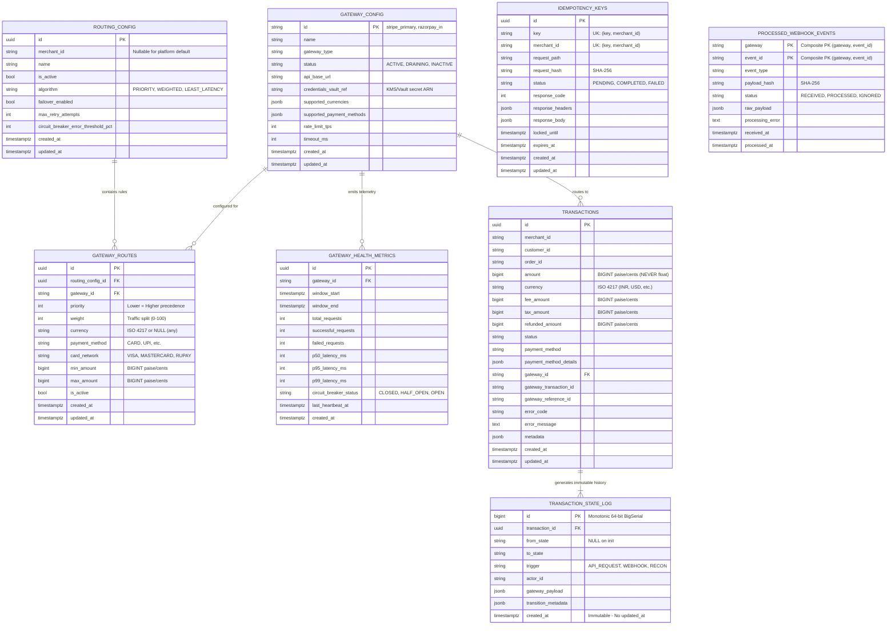
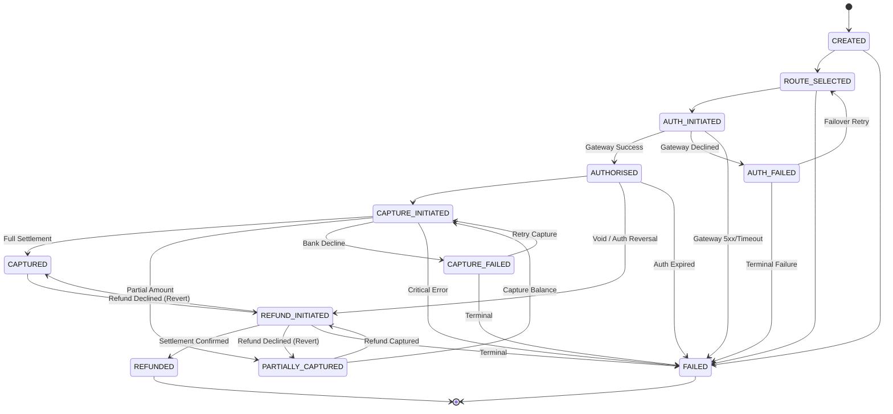
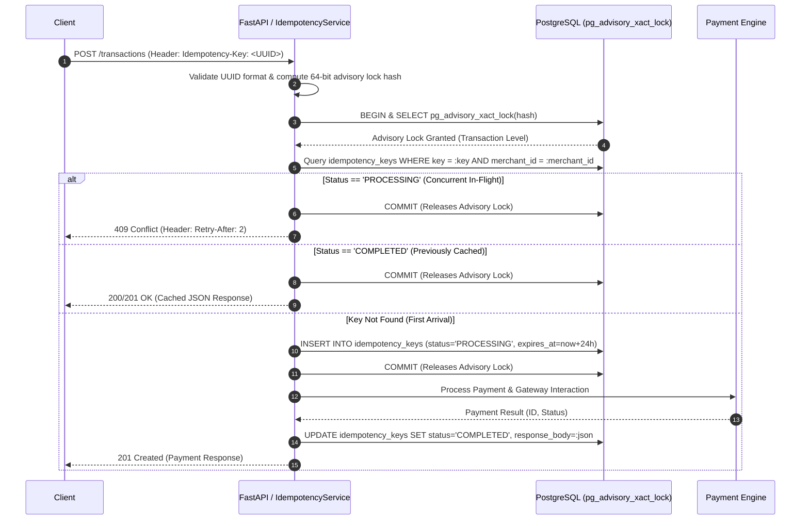
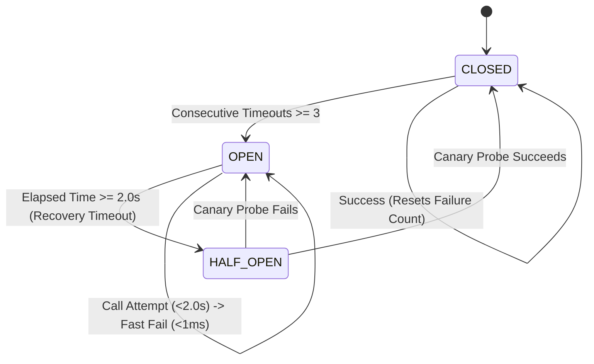
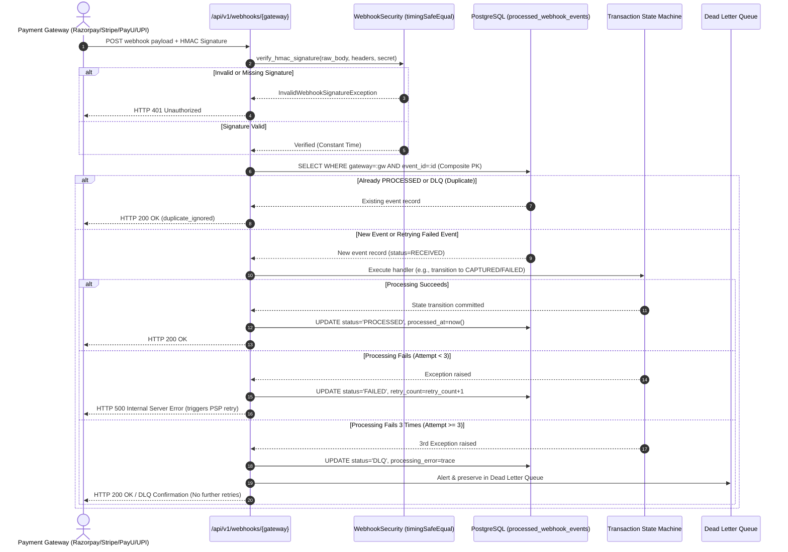
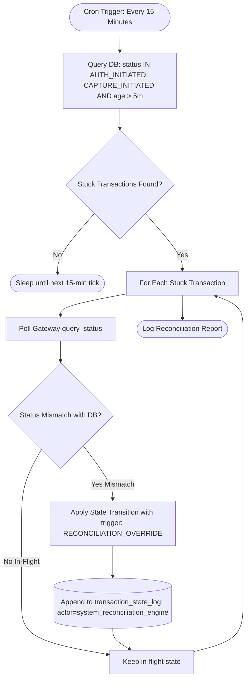

# Payment Orchestration Layer

An enterprise-grade, mission-critical Payment Orchestration Layer built with **FastAPI**, **PostgreSQL**, **SQLAlchemy 2.0 (Async)**, and **Alembic**.

Designed by following strict financial engineering standards (zero float tolerances, immutable audit logs, composite key deduplication, and distributed idempotency locking).

---

## 🏛️ Architectural Mandates & Invariants

### 1. Zero Floating-Point Precision Rule
> **MANDATE**: ALL financial amounts must be represented as **`BIGINT`** storing the smallest minor currency unit (e.g. **paise** for INR, **cents** for USD/EUR, **pence** for GBP). **FLOATS ARE STRICTLY PROHIBITED** across the entire stack—database columns, SQLAlchemy models, and Pydantic validation schemas.
- Example: ₹500.25 is stored strictly as `50025` (BIGINT).
- Eliminates IEEE 754 binary floating-point rounding errors and fractional penny drift.

### 2. Immutable State Transition Audit Trail
> **MANDATE**: The `transaction_state_log` is an append-only ledger.
- Zero in-place updates: rows are never modified once written (`updated_at` column is forbidden).
- Every state shift captures the previous state, new state, triggering actor, source event (API, Webhook, Sweeper, Reconciler), and raw sanitized gateway payload.

### 3. Deterministic Transaction State Machine & Lock Isolation
> **MANDATE**: Enforces 12 strict transaction states with deterministic transition rules.
- Throws `InvalidStateTransitionException` if an illegal transition is attempted (e.g., `CREATED` directly to `REFUNDED`).
- Uses pessimistic row locking (`SELECT ... FOR UPDATE`) during transitions.
- **Lock Release Rule**: The database lock is **strictly committed and released BEFORE invoking external gateway API calls**, preventing connection pool starvation, thread blocking, and database lock exhaustion during upstream PSP latency.

### 4. Asynchronous Webhook Deduplication Engine
> **MANDATE**: `processed_webhook_events` strictly uses a **Composite Primary Key** of `(gateway, event_id)`.
- Eliminates duplicate processing of webhook retries from upstream PSPs (e.g., Stripe, Razorpay, Adyen).
- Guarantees exactly-once asynchronous state reconciliation.

### 5. Distributed Idempotency Engine
> **MANDATE**: `idempotency_keys` enforces distributed lease locking on incoming transaction requests.
- Caches HTTP status codes and responses for repeat submissions with identical payloads.
- Rejects concurrent double-clicks or collisions with `409 Conflict` (`Retry-After`).
- Detects payload mismatch tampering on reused keys with `422 Unprocessable Entity`.

---

## 📊 Database Schema (All 8 Core Tables)



---

## 🔄 Deterministic Transaction State Machine

### The 12 Strict Transaction States
1. `CREATED`: Transaction entity initialized in ledger.
2. `ROUTE_SELECTED`: Target gateway determined by smart routing engine.
3. `AUTH_INITIATED`: In-flight state before initiating gateway authorization call.
4. `AUTHORISED`: Gateway authorization confirmed and funds reserved.
5. `AUTH_FAILED`: Gateway authorization declined (card expired, 3DS failed, fraud reject).
6. `CAPTURE_INITIATED`: In-flight state before initiating capture request.
7. `CAPTURED`: Full transaction amount captured and settled.
8. `PARTIALLY_CAPTURED`: A partial amount of the authorization was captured.
9. `CAPTURE_FAILED`: Capture attempt rejected by issuing bank.
10. `REFUND_INITIATED`: In-flight state before initiating refund/void request.
11. `REFUNDED`: Terminal state; full/partial refund settled.
12. `FAILED`: Terminal unrecoverable failure state.

### State Transition Graph


### Pessimistic Locking & Lock Release Pattern
Holding row locks during upstream HTTP API calls (e.g., Stripe/Adyen/Razorpay) causes connection pool exhaustion, contention, and cascading deadlocks. The `TransactionStateMachine` enforces a two-phase lock release pattern:

```python
from app.services.state_machine import TransactionStateMachine
from app.core.enums import TransactionState, StateTrigger

sm = TransactionStateMachine()

# Phase 1: Lock acquired (SELECT ... FOR UPDATE), state moved to AUTH_INITIATED,
#          state log written, COMMIT executed -> ROW LOCK IS RELEASED!
async with sm.gateway_transition_scope(
    transaction_id=txn_id,
    in_flight_state=TransactionState.AUTH_INITIATED,
    trigger=StateTrigger.GATEWAY_CALL,
    actor_id="service:payment_processor",
) as scope:
    
    # Phase 2: Gateway API executed with ZERO database locks held!
    gateway_response = await psp_client.authorize(amount=txn.amount, currency=txn.currency)
    
    scope.set_success(
        target_state=TransactionState.AUTHORISED,
        gateway_payload=gateway_response.raw_data,
        gateway_transaction_id=gateway_response.charge_id,
    )

# Phase 3: Lock re-acquired, state moved to AUTHORISED, state log written,
#          COMMIT executed -> ROW LOCK RELEASED.
```

---

## ⚡ Idempotency & Distributed Locking Service

### Mission-Critical Concurrency Control
Prevents double-charging, race conditions, and network replay attacks using PostgreSQL transaction-level advisory locks.

1. **Client-Generated UUID (`Idempotency-Key` Header)**:
   - Validates that the key conforms to UUIDv4 format. Rejects malformed or missing headers with `400 Bad Request`.
2. **PostgreSQL Advisory Locks (`pg_advisory_xact_lock`)**:
   - Computes a signed 64-bit integer hash from `(merchant_id, idempotency_key)`:
     $$\text{Lock ID} = \text{int64}(\text{SHA-256}(\text{merchant\_id} : \text{key})[:8])$$
   - Executes `SELECT pg_advisory_xact_lock(:lock_id)`. Serializes concurrent duplicate requests at the database engine level without table-level write locks.
3. **Status `PROCESSING` -> HTTP 409 Conflict**:
   - If an identical key is already actively processing, immediately returns `409 Conflict` with `Retry-After: 2` header, safely rejecting the concurrent attempt.
4. **Status `COMPLETED` -> Cached JSON Response**:
   - If the previous execution was completed successfully, returns the exact cached JSON payload and HTTP status code without re-running any business logic or touching payment gateways.
5. **Payload Tampering Protection**:
   - If a client attempts to reuse an idempotency key with different request parameters (amount, currency, order ID), the service detects the SHA-256 mismatch and returns `422 Unprocessable Content`.
6. **24-Hour Expiration & Automatic Cleanup**:
   - Idempotency records are assigned a 24-hour TTL (`expires_at = now() + 24 hours`).
   - Expired records can be pruned via `idempotency_service.cleanup_expired_keys()` or the maintenance endpoint `POST /api/v1/transactions/idempotency/cleanup`.



---

## 🛡️ Payment Gateway Adapters & Circuit Breaker Pattern

### 1. Unified PaymentGateway Contract
All PSP adapters inherit from the abstract base class `PaymentGateway` and implement:
- `authorize(request: GatewayAuthRequest) -> GatewayAuthResponse`
- `capture(request: GatewayCaptureRequest) -> GatewayCaptureResponse`
- `refund(request: GatewayRefundRequest) -> GatewayRefundResponse`

### 2. Supported Mock Implementations
- **Razorpay**: Returns `pay_...` IDs, 12-digit RRNs, and standard Razorpay JSON payloads.
- **Stripe**: Returns `pi_...` PaymentIntents, `ch_...` charges, and ARNs.
- **PayU**: Returns `payu_...` transaction IDs, `mihpayid`, and bank reference numbers.
- **UPI**: Direct UPI rail adapter returning standard NPCI 12-digit RRNs and `00` success response codes.

### 3. Simulation via `X-Mock-Response` Header
Each mock adapter inspects the `X-Mock-Response` HTTP header to simulate upstream production edge cases:
- `X-Mock-Response: timeout`: Simulates network lag and raises `GatewayTimeoutException`.
- `X-Mock-Response: decline`: Simulates bank decline and raises `GatewayDeclinedException`.
- `X-Mock-Response: unavailable` / `500`: Raises `GatewayServiceUnavailableException`.
- `X-Mock-Response: network_error`: Raises `GatewayException` (connection reset).

### 4. Circuit Breaker FSM (CLOSED, OPEN, HALF-OPEN)
Tracks consecutive upstream timeouts and failures per gateway to fail-fast and prevent resource exhaustion:



### 5. Fast-Fail & 2-Second Alternate Gateway Routing
When a primary gateway encounters repeated timeouts:
1. It trips to **`OPEN`** after 3 consecutive failures.
2. Subsequent calls to that gateway **fail-fast in <1ms** with `CircuitBreakerOpenException` without touching the network.
3. The `ResilientGatewayRouter` instantly falls over to the next priority gateway (e.g. Razorpay -> Stripe -> PayU -> UPI).
4. After **2 seconds**, the tripped gateway automatically moves to **`HALF_OPEN`** to canary-probe for upstream recovery.

---

## 🚀 Quickstart & Setup
- Python 3.11+
- PostgreSQL 14+ (or compatible DB)

### 2. Install Dependencies
```bash
python -m venv .venv
# On Windows:
.venv\Scripts\activate
# On Linux/macOS:
source .venv/bin/activate

pip install -r requirements.txt
```

### 3. Database Migrations (Alembic)

To generate offline static SQL for verification or production DBAs:
```bash
alembic upgrade head --sql
```

To apply migrations online to the target PostgreSQL database:
```bash
alembic upgrade head
```

To roll back migration:
```bash
alembic downgrade -1
```

### 4. Running the Application
```bash
uvicorn app.main:app --reload --port 8000
```
- Interactive Swagger UI: [http://localhost:8000/docs](http://localhost:8000/docs)
- Interactive ReDoc: [http://localhost:8000/redoc](http://localhost:8000/redoc)
- Health Check: [http://localhost:8000/health](http://localhost:8000/health)

### 5. Running Tests
```bash
pytest -v
```

---

## 🔒 Financial Precision Verification

Our test suite rigorously verifies that:
1. Every monetary column across `transactions` and `gateway_routes` is an instance of `sqlalchemy.BigInteger`.
2. Zero `Float` or `Double` precision types exist in any financial column.
3. `processed_webhook_events` is anchored by the composite primary key `(gateway, event_id)`.
4. `transaction_state_log` has no `updated_at` column, guaranteeing immutable audit trails.
5. Pydantic request models fail validation if a float amount is submitted (e.g. `500.50`), requiring exact integer minor units (e.g. `50050` paise).

---

## ⚡ Webhook Ingestion Pipeline & Dead Letter Queue (DLQ)

The Payment Layer features an industrial webhook ingestion pipeline supporting our 4 primary payment gateways (`razorpay`, `stripe`, `payu`, and `upi`).

### 1. Timing-Attack Safe HMAC-SHA256 Verification
All incoming webhooks undergo cryptographic HMAC-SHA256 verification using Python's `hmac.compare_digest` (`timingSafeEqual`) to eliminate side-channel timing attacks:
- **Razorpay**: Header `X-Razorpay-Signature` verified against raw request bytes.
- **Stripe**: Header `Stripe-Signature` (`t={timestamp},v1={hash}`) verified against `{timestamp}.{raw_body}`.
- **PayU**: Header `X-PayU-Signature` verified against raw request bytes.
- **UPI**: Header `X-UPI-Signature` / `X-NPCI-Signature` verified against raw request bytes.
- Unauthorized or forged signatures immediately return **`401 Unauthorized`**.

### 2. Idempotent Deduplication (Composite Primary Key)
To prevent duplicate processing of asynchronous PSP webhook retries:
- The `event_id` is extracted and queried against `processed_webhook_events` using composite primary key `(gateway, event_id)`.
- If the event is already marked as `PROCESSED` or `DLQ`, the pipeline returns **`HTTP 200 OK`** (`duplicate_ignored`) immediately without re-triggering business logic or state transitions.

### 3. Dead Letter Queue (DLQ) Pattern
If a webhook handler fails to process an event:
- The system increments `retry_count`.
- If processing fails **3 times** (`retry_count >= 3`), the event is automatically transitioned to status **`DLQ`**.
- The raw payload and failure exception are permanently preserved in `processed_webhook_events` for auditing and manual replay via the `/api/v1/webhooks/dlq/{gateway}/{event_id}/replay` API.

### Webhook Ingestion Sequence Diagram



---

## 💳 Payments REST APIs & Uniform Error Formatting

The orchestrator surfaces production REST APIs for end-to-end payment lifecycles:

### 1. Endpoint Specifications
- **`POST /api/v1/payments`**: Initiates a payment. Enforces strict integer minor unit amounts (BIGINT paise/cents), distributed advisory locking via `Idempotency-Key`, dynamic multi-criteria gateway routing, and deterministic state transitions.
- **`POST /api/v1/payments/{id}/capture`**: Settles an authorized payment (`AUTHORISED` -> `CAPTURE_INITIATED` -> `CAPTURED`). Database locks are released prior to external PSP invocation.
- **`POST /api/v1/payments/{id}/refund`**: Issues full or partial refunds for settled payments (`CAPTURED` -> `REFUND_INITIATED` -> `REFUNDED`).
- **`POST /api/v1/payments/webhooks/{gateway}`**: Unified webhook intake delegated to the HMAC-verified deduplication pipeline.

### 2. Uniform Error Envelope
All errors across the platform are formatted uniformly to guarantee standard client contract handling:

```json
{
  "error": {
    "code": "PAYMENT_DECLINED",
    "message": "Transaction declined by issuing bank via gateway 'stripe'",
    "details": {
      "gateway_error_code": "CARD_DECLINED"
    }
  }
}
```

---

## 🔄 Automated Reconciliation Engine (Background Cron)

The **Reconciliation Engine** runs on a standing **15-minute cron schedule** (interval = 900s) to guarantee eventual consistency and auditability against silent network failures:

1. **Stuck Transaction Detection**: Scans for transactions stuck in **`AUTH_INITIATED`** or **`CAPTURE_INITIATED`** for **> 5 minutes**.
2. **Upstream Gateway Polling**: Queries the assigned PSP adapter (`query_status`) for the true source-of-truth status.
3. **`RECONCILIATION_OVERRIDE` Audit Event**: If a mismatch is detected (e.g., PSP confirms authorization or capture occurred while DB remained in initiated state), the engine executes the state transition and automatically records an immutable ledger log entry with `trigger="RECONCILIATION_OVERRIDE"`, `actor_id="system_reconciliation_engine"`, and raw gateway telemetry.




