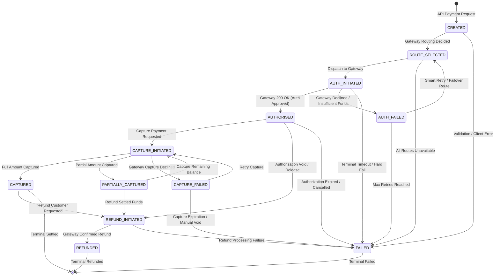

# ZeTheta Payment Orchestration Layer — Transaction State Machine

## 1. Overview & Core Invariants

The ZeTheta Payment Orchestration Layer enforces a **deterministic finite-state machine (FSM)** for all payment transactions. The state machine guarantees financial consistency, auditability, and concurrency safety.

### Core Architectural Rules:
1. **12 Mandatory States**: Exactly 12 strict states are defined. No intermediate, undefined, or implicit states are permitted.
2. **Deterministic Enforcement**: Transitions are strictly validated against a directed graph `ALLOWED_TRANSITIONS`. Attempting an illegal transition (e.g., `CREATED` directly to `REFUNDED`) immediately raises `InvalidStateTransitionException` and halts execution.
3. **Pessimistic Locking Decoupled from External I/O**: During transitions involving third-party payment gateways, row locks (`SELECT FOR UPDATE`) are acquired and released in two separate short-lived phases, ensuring zero locks are held during external network latency.
4. **Immutable State Audit Ledger**: Every state transition automatically writes a row to the `transaction_state_log` table recording previous state, new state, trigger event, actor, gateway response payload, and timestamps.

---

## 2. Mermaid.js State Transition Diagram

The following Mermaid.js diagram maps out all 12 transaction states and legal transitions:



---

## 3. The 12 Mandatory States & Definitions

| # | State Enum | Category | Description |
| :-: | :--- | :--- | :--- |
| 1 | `CREATED` | Initial | The payment intent has been instantiated in the database ledger. |
| 2 | `ROUTE_SELECTED` | Pre-Processing | The smart routing algorithm evaluated gateway scores and assigned a primary PSP. |
| 3 | `AUTH_INITIATED` | In-Flight (Transient) | Pre-auth lock released; HTTP request dispatched to the payment gateway. |
| 4 | `AUTHORISED` | Authorized | Funds have been successfully authorized/blocked by the issuing bank/PSP. |
| 5 | `AUTH_FAILED` | Intermediate Failure | Authorization failed (e.g., declined card, insufficient funds); eligible for smart failover retry. |
| 6 | `CAPTURE_INITIATED` | In-Flight (Transient) | Pre-capture lock released; capture request dispatched to the payment gateway. |
| 7 | `CAPTURED` | Terminal Success | Funds have been completely captured and settled into the merchant account. |
| 8 | `PARTIALLY_CAPTURED`| Intermediate Success | A portion of authorized funds was captured; remainder can be captured or released. |
| 9 | `CAPTURE_FAILED` | Intermediate Failure | Capture request was rejected by the gateway; eligible for retry or authorization void. |
| 10 | `REFUND_INITIATED` | In-Flight (Transient) | Pre-refund lock released; refund instruction submitted to the payment gateway. |
| 11 | `REFUNDED` | Terminal Success | Funds have been successfully refunded to the customer. |
| 12 | `FAILED` | Terminal Failure | The transaction experienced a terminal failure and cannot be further processed. |

---

## 4. Allowed Transition Matrix

The table below outlines the transition graph strictly enforced in `app/services/state_machine.py`:

| Source State | Permitted Destination States | Primary Triggers |
| :--- | :--- | :--- |
| `CREATED` | `ROUTE_SELECTED`, `FAILED` | `ROUTE_SELECTED`, `CLIENT_CANCEL` |
| `ROUTE_SELECTED` | `AUTH_INITIATED`, `FAILED` | `GATEWAY_DISPATCH`, `ROUTE_EXHAUSTION` |
| `AUTH_INITIATED` | `AUTHORISED`, `AUTH_FAILED`, `FAILED` | `GATEWAY_SUCCESS`, `GATEWAY_DECLINE`, `TIMEOUT` |
| `AUTHORISED` | `CAPTURE_INITIATED`, `REFUND_INITIATED`, `FAILED` | `CAPTURE_REQUEST`, `AUTH_VOID`, `AUTH_EXPIRE` |
| `AUTH_FAILED` | `ROUTE_SELECTED`, `FAILED` | `FAILOVER_RETRY`, `MAX_RETRIES` |
| `CAPTURE_INITIATED` | `CAPTURED`, `PARTIALLY_CAPTURED`, `CAPTURE_FAILED` | `CAPTURE_CONFIRMED`, `PARTIAL_SETTLE`, `DECLINED` |
| `CAPTURED` | `REFUND_INITIATED` | `REFUND_REQUEST` |
| `PARTIALLY_CAPTURED`| `CAPTURE_INITIATED`, `REFUND_INITIATED` | `SUBSEQUENT_CAPTURE`, `REFUND_REQUEST` |
| `CAPTURE_FAILED` | `CAPTURE_INITIATED`, `FAILED` | `RETRY_CAPTURE`, `ABANDON_CAPTURE` |
| `REFUND_INITIATED` | `REFUNDED`, `FAILED` | `GATEWAY_REFUND_SUCCESS`, `REFUND_ERROR` |
| `REFUNDED` | *(Terminal)* | None |
| `FAILED` | *(Terminal)* | None |

---

## 5. Concurrency & Pessimistic Locking Protocol

A critical vulnerability in financial systems is holding open database row locks while awaiting external HTTP responses, leading to connection pool exhaustion and thread starvation. ZeTheta eliminates this hazard via a **Three-Phase Decoupled Lock Protocol**:

```
        Application                      PostgreSQL DB                   External Gateway
             |                                 |                                 |
    [Phase 1: In-Flight Lock]                  |                                 |
             |--- SELECT ... FOR UPDATE ------>|                                 |
             |<-- Lock Acquired ---------------|                                 |
             |--- Update: AUTH_INITIATED ----->|                                 |
             |--- Insert: State Log ----------->|                                 |
             |--- COMMIT (Releases Lock) ----->|                                 |
             |<-- Lock Completely Released ----|                                 |
             |                                 |                                 |
    [Phase 2: External Gateway API Call]       |                                 |
             |----------------------- POST /charges / auth --------------------->|
             |                                                                   |
             |   (Zero database locks are held during network round trip)       |
             |                                                                   |
             |<---------------------- Response / Webhook ------------------------|
             |                                 |                                 |
    [Phase 3: Terminal Settlement Lock]        |                                 |
             |--- SELECT ... FOR UPDATE ------>|                                 |
             |<-- Lock Re-Acquired ------------|                                 |
             |    (Assert status unchanged)    |                                 |
             |--- Update: AUTHORISED --------->|                                 |
             |--- Insert: State Log ----------->|                                 |
             |--- COMMIT (Releases Lock) ----->|                                 |
             |<-- Lock Completely Released ----|                                 |
             v                                 v                                 v
```

### Protection Against Concurrent State Mutations
During Phase 2, if a concurrent actor (e.g. an asynchronous gateway webhook or timeout sweeper) mutates the transaction status, Phase 3 detects the conflict when re-acquiring the row lock:
```python
if txn.status != in_flight_state.value:
    raise ConcurrentStateMutationException(
        transaction_id=transaction_id,
        expected_state=in_flight_state.value,
        actual_state=txn.status,
    )
```

---

## 6. Audit Trail Logging (`transaction_state_log`)

Every transition step produces an immutable record with:
* `id`: Unique UUIDv4 log identifier
* `transaction_id`: Target transaction reference
* `from_state`: Preceding state
* `to_state`: Resultant state
* `trigger`: Event that initiated the transition (`API_REQUEST`, `GATEWAY_WEBHOOK`, `RECONCILIATION_OVERRIDE`, etc.)
* `actor_id`: Identity of the triggering service, worker, or administrator
* `gateway_id`: Identifier of the gateway that processed the step
* `gateway_payload`: Sanitized JSON payload received from the gateway
* `created_at`: UTC timestamp of transition commit

